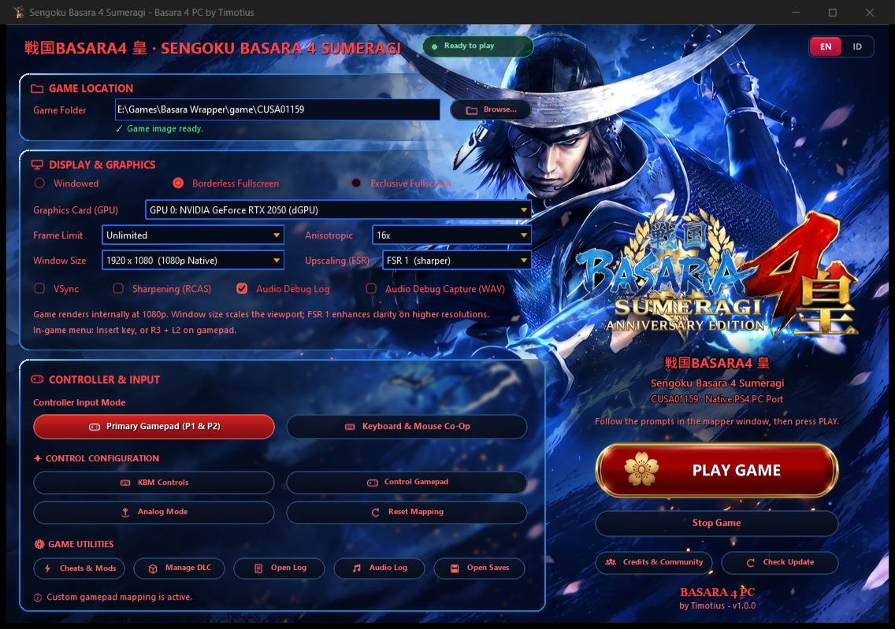

# 戦国BASARA4 皇 — Sengoku Basara 4 Sumeragi (Native PC Port & Launcher)


> **Native Windows x64 PC Port & Custom Desktop Launcher for Sengoku Basara 4 Sumeragi (`CUSA01159`).**  
> Built with direct x86-64 CPU execution, real-time Orbis OS to Win32 syscall translation, Vulkan SPIR-V graphics pipeline with AMD FSR 1.0 & RCAS, hardware-synchronized ATRAC9 audio, and a custom 60 FPS hardware-sliced UI engine by **Timotius**.



---

## ✨ Key Highlights

- **Direct Native x86-64 Execution:** Runs PS4 (`CUSA01159`) binaries directly on Windows x64 without heavy CPU emulation overhead via the **Ponytail Binary Translation Runtime**.
- **Vulkan Graphics & AMD FidelityFX Upscaling:** Translates PlayStation GNM/GNMX draw calls directly to Vulkan SPIR-V with integrated **AMD FSR 1.0** upscaling and **RCAS (Robust Contrast Adaptive Sharpening)**.
- **Zero-Desync ATRAC9 Audio Engine:** Hardware-locked 16-bit 48kHz PCM ring-buffer synchronized to the master `AudioOut` PTS clock, eliminating cutscene stutters and static noise.
- **Custom Hardware-Sliced Glass UI:** Lightweight native Python 3.12 + Tkinter/Pillow Single-Canvas engine featuring real-time viewport slicing, 2x-supersampled RGBA texture caching (`_BTN_CACHE`), 60 FPS interactive micro-animations, and instant **English (`EN`) / Indonesian (`ID`)** localization.
- **Plug-and-Play Controller & Co-Op Support:** Native SDL2 input subsystem supporting XInput, DirectInput, DualShock 4, DualSense, custom analog deadzone calibration, and **Keyboard & Mouse Co-Op**.

---

## 🛠️ Launcher Features & Settings Breakdown

### 1. Real-Time Game Directory Scanner & Status Header
- **Automatic `/game` Verification:** Dynamically validates the integrity of `game/CUSA01159` (`eboot.bin`, `sce_sys/param.sfo`, `icon0.png`, and `content_profile.py`).
- **Live Status Indicator:** Displays a green **`Ready to play` (`Siap dimainkan`)** badge when valid, or switches to a red **`Game not ready` (`Game belum siap`)** alert with a floating warning banner if the game files are missing from `/game`.
- **Instant Localization (`EN` | `ID`):** Top-right toggle switches the entire interface, tooltips, and dialogs between English and Bahasa Indonesia in real time.

### 2. Game Location (`Lokasi Game`)
- **Game Folder Path:** Displays and configures the active path to your extracted `CUSA01159` directory.
- **Browse (`Pilih Folder...`):** Interactive directory picker with instant image integrity verification.

### 3. Display & Graphics (`Tampilan & Grafis`)
- **Display Modes:**
  - `Windowed` (`Jendela`)
  - `Borderless Fullscreen` (`Layar Penuh Borderless`)
  - `Exclusive Fullscreen` (`Layar Penuh Eksklusif`)
- **Hardware & Rendering Controls:**
  - **Graphics Card (GPU):** Select your preferred dedicated or integrated Vulkan-capable GPU.
  - **Frame Limit (`Batas FPS`):** Lock target framerate or run `Unlimited`.
  - **Anisotropic Filtering:** Texture filtering quality up to `16x`.
  - **Window Size (`Ukuran Resolusi`):** Scale output viewport (`1280x720`, `1920x1080`, `2560x1440`, `3840x2160`) while maintaining native 1080p internal rendering.
  - **Upscaling (`FSR`):** Enable **AMD FidelityFX Super Resolution 1.0 (`FSR 1 - sharper`)** for high-clarity upscaling on 1440p/4K displays.
- **Visual & Diagnostic Toggles:**
  - `VSync`: Vertical synchronization to prevent screen tearing.
  - `Sharpening (RCAS)`: AMD Robust Contrast Adaptive Sharpening filter.
  - `Audio Debug Log`: Real-time ATRAC9/AC3 audio stream telemetry.
  - `Audio Debug Capture (WAV)`: Dump decoded PCM audio streams to `.wav` for diagnostics.
- **In-Game Overlay Shortcut:** Press **`Insert`** on keyboard or **`R3 + L2`** on gamepad during gameplay to open the in-game runtime menu.

### 4. Controller & Input (`Kontroler & Input`)
- **Controller Input Mode (`Mode Input Kontroler`):**
  - `Primary Gamepad (P1 & P2)`: Standard single or two-player gamepad mode (Xbox, DualShock 4, DualSense, DirectInput).
  - `Keyboard & Mouse Co-Op`: Enables split input for local co-op across Keyboard/Mouse and Gamepad.
- **Control Configuration (`Pengaturan Kontrol`):**
  - `KBM Controls` (`Kontrol KBM`): Customize keyboard keys and mouse bindings.
  - `Control Gamepad` (`Atur Gamepad`): Interactive SDL2 button remapper saved to `user/gamepad_mapping.txt`.
  - `Analog Mode` (`Mode Analog`): Configure left/right stick deadzones, camera sensitivity, and axial response curves.
  - `Reset Mapping`: Restore controller bindings to factory defaults.

### 5. Game Utilities (`Utilitas & Mods`)
- **`⚡ Cheats & Mods` (`Mod & Cheat`):** Manage runtime patches, gameplay toggles, and custom mod overrides.
- **`📦 Manage DLC` (`Kelola DLC`):** Opens the **Extracted Basara 4 DLC Manager** to scan, verify entitlements, inspect Content IDs, and validate DLC metadata before launch.
- **`📄 Open Log` (`Buka Log`):** Quick access to runtime execution and syscall translation logs.
- **`🎵 Audio Log` (`Log Audio`):** Inspect AV clock synchronization and ATRAC9 decoder logs.
- **`💾 Open Saves` (`Data Save`):** Directly open the local PS4 save data directory.

---

## ⚙️ Low-Level Architecture

1. **Frontend UI Engine (Python 3.12 + PIL Viewport Slicing):**
   - Runs in-process via an embedded Python 3.12 C-runtime (`_internal/python312.dll`) without heavy Electron or WPF memory overhead.
   - Overcomes native Windows Tkinter alpha limitations using a **Single-Canvas Viewport Slicing Engine** that composites translucent glass cards, horizontal alpha gradients, and 2x-supersampled RGBA button textures at 60 FPS.
2. **Binary Translation Core (Ponytail Runtime):**
   - Dynamically loads the PS4 `eboot.bin` executable and translates FreeBSD/Orbis OS kernel calls (`sceKernel*`, `scePthread*`, `sceNet*`) directly to native Win32 API calls.
3. **Graphics & Multimedia Pipeline:**
   - **GNM to Vulkan:** Translates PlayStation shader and command buffers to Vulkan SPIR-V with FSR 1.0 + RCAS post-processing.
   - **AV Master Clock Sync:** Demuxes USM/MP4 cutscenes and binds the ATRAC9/AC3 48kHz PCM ring-buffer and video frame presenter to the `AudioOut` PTS clock.

---

## 🚀 How to Install & Use

1. **Download Release `v1.0.0`:**
   - Download the latest release package from the [Releases](../../releases) page and extract it to a folder on your PC (e.g., `E:\Games\Basara Wrapper`).
2. **Place Your Game Files in `/game`:**
   - Copy your extracted *Sengoku Basara 4 Sumeragi* (`CUSA01159`) game directory into the launcher's `/game` folder:
     ```text
     <Launcher_Root>/
     ├── game/
     │   └── CUSA01159/
     │       ├── eboot.bin
     │       └── sce_sys/
     ├── assets/
     └── Basara4Launcher.exe
     ```
3. **Configure & Launch:**
   - Run **`Basara4Launcher.exe`** (or `Sengoku Basara 4.exe`).
   - Ensure the top status badge shows **`● Ready to play`** (`✓ Game image ready.`).
   - Select your GPU, display mode, FSR/RCAS preferences, and controller mode.
   - Click **`PLAY GAME`** (`MAINKAN GAME`) to start!

---

## 📦 Release Notes — `v1.0.0`
- **Initial Official Release (`v1.0.0`) by Timotius.**
- Redesigned Sengoku Basara 4 Sumeragi custom glass UI with seamless Date Masamune background slicing and 60 FPS luxury gold/crimson button animations.
- Added real-time `/game` folder integrity scanner with dynamic status indicators and floating warning notifications.
- Full bilingual support (**English** & **Bahasa Indonesia**).
- Upgraded **Extracted Basara 4 DLC Manager**, **KBM/Gamepad Mapper**, and **Vulkan FSR 1.0 + RCAS** graphics configuration suite.

---

## 👤 Credits & License
- **Lead Developer & Maintainer:** **Timotius**
- *Sengoku Basara 4 Sumeragi* is a trademark of CAPCOM CO., LTD. This project is a non-commercial native PC runtime wrapper and launcher developed for educational and preservation purposes. No copyrighted game assets or ROM/PKG dumps are hosted in this repository.
