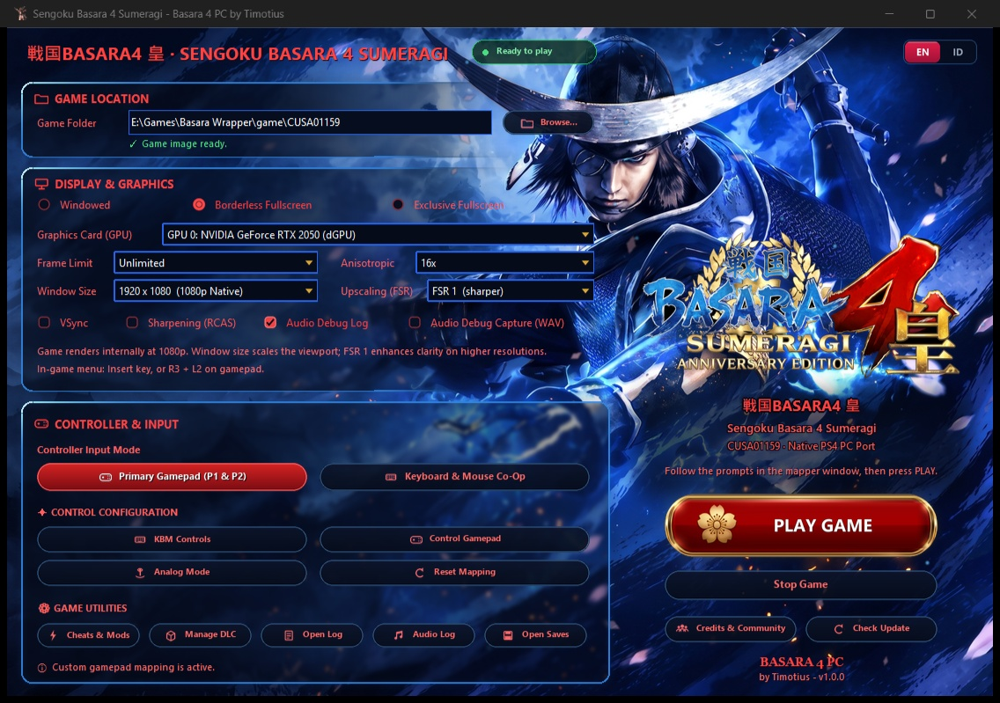

# 戦国BASARA4 皇 — Sengoku Basara 4 Sumeragi (Native PC Port & Launcher)


> **Native Windows x64 PC Port & Custom Desktop Launcher for Sengoku Basara 4 Sumeragi (`CUSA01159`).**  
> Built with direct x86-64 CPU execution, real-time Orbis OS to Win32 syscall translation, Vulkan 1.3 SPIR-V graphics pipeline with AMD FSR 1.0 & RCAS, hardware-synchronized ATRAC9 audio, unified No-Console SDL2 Controller GUI, F11 Tracer & Session Report bundler, and a custom 60 FPS hardware-sliced UI engine by **Timotius**.



---

## 🆕 What's New in `v1.0.9`

### Graphics Fixes
- **AMD iGPU Ultimate-Attack Darkening Fix:** Resolved a screen-darkening regression during ultimate/Basara attacks on AMD integrated GPUs when running at `540p` or `1080p`.
- **Cutscene Doubled-Picture Fix:** Fixed doubled/ghosted video picture during pre-rendered cutscenes across discrete GPUs and integrated GPUs, including stages that switch into a boss cutscene at native `1080p`.
- **Menu Cursor Glow & Highlight Alignment (`e2d_node_pos_patch`):** Fixed main-menu and pause-menu cursor glow and selection highlight misalignment at `720p`, `1080p`, and `1440p`.
- **480p Right-Edge Smear Fix (`RENDER_TILE = 20`):** Internal render resolution at `480p` is now tile-aligned to **`860×480`** (multiple of the game's 20×20 render tile grid) instead of `854×480`, eliminating right-edge framebuffer smearing.
- **High-Resolution Memory Headroom:** Automatically allocates `4800 MB` direct memory (`SPARTAN_DMEM_MB=4800`) at `1440p`, `1800p`, and `4K`.

### Crash Reports & Pre-Launch Diagnostics
- **Readable Crash Dumps (`user/crash/`):** Native crashes now write human-readable register, fault module, and stack diagnostics to `user/crash/crash-<timestamp>.txt` and display a hardware-aware explanation in the launcher.
- **Vulkan 1.3 Pre-Launch Check:** Before launching the game, the launcher probes `vulkan-1.dll` (`vkEnumerateInstanceVersion` and `vkEnumeratePhysicalDevices`) and displays a themed dark-navy + Samurai Red warning modal listing detected GPUs, Vulkan versions, and quick links to official NVIDIA/AMD/Intel drivers if Vulkan 1.3 is missing or outdated (while still allowing you to launch).
- **Small-Screen Crash Dialog (`1366×768` Ready):** Crash diagnostic window dynamically fits low-resolution displays with a scrollable diagnostic pane and an always-reachable bottom action bar (**`Save Report (.zip)`**, **`Copy Summary`**, **`Open Log`**, **`GitHub Issues`**).

### Force Stop (Two-Stage Game Shutdown)
- **Stage 1 (`Stop Game` / `Hentikan Game`):** Sends a graceful `WM_CLOSE` to the game window so in-flight save data can finish writing cleanly.
- **Stage 2 (`Force Stop` / `Paksa Berhenti`):** Turning crimson after the first click, a second click immediately terminates (`kill()`) a frozen or unresponsive game process.

### Tracer & Report System (`F11` In-Game Capture)
- **Unified `Tracer` Toggle:** Replaces the old `Audio Debug Log` checkbox, enabling both `render_trace.log` and `audio_debug.log` plus in-game **`F11`** frame capture (`SPARTAN_FRAME_CAPTURE_KEY=1`).
- **One-Click `Report (F11)` Bundler (`< 9 MB` Zip):** Clicking **`Report (F11)`** (`Laporan (F11)`) packages a privacy-masked session report (`user/reports/basara4-report-<session>.zip`) containing `report.json`, `summary.txt`, `last_run.log`, `render_trace.log`, `audio_debug.log`, crash dumps, and compressed **`F11`** screenshots while redacting your Windows username and local drive paths (`<ROOT>`, `<GAME>`, `<DLC>`, `<USER>`).
- **Automatic 20-Session Pruner & Startup Cleanup:** Automatically keeps only the latest 20 session folders and cleans stale unbundled Tracer logs on startup so disk space never balloons.

### Unified No-Console Controller Mapping GUI
- **Single-Window Live Gamepad Setup (`basara4_controller.py`):** Clicking **`Control Gamepad`** (`Atur Gamepad`) now opens a rich graphical controller configurator talking to `basara4-pad-mapper.exe --ui` over background JSON IPC (`CREATE_NO_WINDOW`) — **no command-prompt window ever pops up**.
- **Interactive Button Wizard, Live Stick Visualizer & Deadzone Calibration:** Features step-by-step button binding (`Skip`, `Undo`, `Cancel`), live 2D left/right analog crosshairs, stick-only calibration, and quick access to manual Xbox / PlayStation / Switch presets.
- **Atomic Backup & Restore Safeguard:** Snapshots `user/gamepad_mapping.txt` before opening and automatically restores your previous mapping if setup is cancelled or closed early.

### High-DPI & Short-Screen Responsiveness (`125%` / `150%` Scaling)
- **Mouse-Wheel Left-Column Scroll:** On `1080p` laptops running at `125%` or `150%` Windows DPI scaling (or `< 720px` effective height), scrolling the mouse wheel over the left cards smoothly scrolls all settings while keeping the **`PLAY GAME`** (`MAINKAN GAME`) button reachable at all times.
- **Flexible Recursive DLC Scanner & Bundled `iced-x86`:** Detects all extracted DLC folders under `DLC/` or `user/dlc/` by recursively locating `sce_sys/param.sfo` (including across directory junctions) and bundles `iced-x86` inside `_internal/` so first-time `isa_rewrite.py` preparation succeeds on all CPUs.

> **Upgrading from `v1.0.9-beta` or earlier:** If you previously tested an earlier build, run **`Sengoku Basara 4.exe`** (or `Basara4Launcher.exe`), verify your game folder points to `game/CUSA01159`, and click **`PLAY GAME`**. If `eboot.bin` or runtime patches were updated, the launcher will automatically refresh `out/patches.bin` and `out/content.bin` while preserving your `user/savedata/`.

---

## 🛠️ Launcher Features & Settings Breakdown

### 1. Real-Time Game Directory Scanner & Status Header
- **Automatic `/game` Verification:** Dynamically validates `game/CUSA01159` (`eboot.bin` and `sce_sys/param.sfo`).
- **Live Status Indicator:** Displays a green **`Ready to play` (`Siap dimainkan`)** badge when valid, or switches to a red **`Game not ready` (`Game belum siap`)** alert with a floating warning banner if the game files are missing.
- **Instant Localization (`EN` | `ID`):** Top-right toggle switches the entire interface, tooltips, and v1.0.9 dialogs between English and Bahasa Indonesia in real time.

### 2. Display & Graphics (`Tampilan & Grafis`)
- **Display Modes:** `Windowed` (`Jendela`), `Borderless Fullscreen` (`Layar Penuh Borderless`), `Exclusive Fullscreen` (`Layar Penuh Eksklusif`).
- **Graphics Card (GPU):** Auto-prioritizes discrete Vulkan 1.3 GPUs or lets you bind a specific adapter.
- **Frame Limit (`Batas FPS`):** `60 (native)`, `90`, `120`, `144`, `165`, `240`, or `Unlimited`.
- **Render Resolution (`Ukuran Resolusi`):**
  - Performance sub-native: `640×360 (360p)`, `860×480 (480p tile-aligned)`, `960×540 (540p)`, `1280×720 (720p)`, `1600×900 (900p)`.
  - Native & High-Res: `1920×1080 (1080p Native)`, `2560×1440 (1440p)`, `3200×1800 (1800p)`, `3840×2160 (4K)`.
- **Upscaling (`FSR`):** `Off` or **AMD FidelityFX Super Resolution 1.0 (`FSR 1 - sharper`)**.
- **Visual & Diagnostic Controls:** `VSync`, `Sharpening (RCAS)`, `Tracer` (Render + Audio + F11 capture), `Audio WAV Capture`, and **`Report (F11)`** (`Laporan (F11)`).
- **In-Game Shortcuts:**
  - **`Insert`** or **`R3 + L2`**: Toggle in-game overlay menu.
  - **`F11`** (with `Tracer` enabled): Capture diagnostic frame + render trace snapshot for `Report (F11)`.
  - **`F12`**: Save standard screenshot.

### 3. Controller & Input (`Kontroler & Input`)
- **Controller Input Mode:** `Primary Gamepad (P1 & P2)` or `Keyboard & Mouse Co-Op`.
- **Control Configuration:**
  - `KBM Controls` (`Kontrol KBM`): Customize keyboard keys, mouse camera lock, and aim sensitivity.
  - `Control Gamepad` (`Atur Gamepad`): Opens the **Unified No-Console Controller Mapping GUI** with live stick visualization, interactive button wizard, and manual presets.
  - `Analog Mode` (`Mode Analog`): Deadzone & camera sensitivity sliders + direct hardware stick calibration.
  - `Reset Mapping`: Restore controller bindings to default XInput layout.

### 4. Game Utilities (`Utilitas & Mods`)
- **`⚡ Cheats & Mods` (`Mod & Cheat`):** Toggle built-in GoldHEN runtime cheats (Max Basara Gauge, Max Health, Infinite Drive, Max Zenny, All Weapons/Inscriptions).
- **`📦 Manage DLC` (`Kelola DLC`):** Recursive extracted DLC scanner & entitlement verifier supporting all 56 add-ons.
- **`📄 Open Log` (`Buka Log`):** Open `user/last_run.log`.
- **`🎵 Audio Log` (`Log Audio`):** Open `user/audio_debug.log`.
- **`💾 Open Saves` (`Data Save`):** Open `user/savedata/`.

---

## ⚙️ Architecture Overview

1. **Single-Canvas Pillow UI Engine (`_internal/python312.dll` + `launcher/basara4_launcher.py`):**
   - Lightweight native Python 3.12 + Tkinter/Pillow Single-Canvas compositor with 2x-supersampled `_BTN_CACHE` pill buttons, 60 FPS luxury gold hover animations, bilingual **`EN | ID`** switching, and High-DPI mouse-wheel scrolling on constrained displays.
2. **Ponytail Binary Translation Core (`bin/basara4-core.exe` + `scripts/prepare.py`):**
   - Executes PS4 `eboot.bin` x86-64 code natively on Windows x64, translates Orbis OS system calls directly to Win32, and rewrites legacy ISA instructions via the bundled `iced-x86` disassembler on first launch.
3. **Graphics, Audio & Input Pipeline:**
   - **Vulkan 1.3 + FSR 1.0 & RCAS:** Translates PS4 GNM/GNMX draw calls to Vulkan SPIR-V with tile-aligned (`RENDER_TILE = 20`, `860×480` at `480p`) scaling and `e2d_node_pos_patch` menu highlight calibration.
   - **ATRAC9 Audio & No-Console SDL2 Input:** Hardware-synchronized 48kHz PCM audio output paired with `bin/basara4-pad-mapper.exe --ui` over background JSON IPC (`basara4_controller.py`), plus F11 Tracer & `< 9 MB` masked Report zip bundling (`basara4_report.py`).

---

## 🚀 How to Install & Use

1. **Download Release `v1.0.9`:**
   - Download the latest release from [Releases](https://github.com/aldoroku76-netizen/Basara-4-Sumeragi-ver.Masamune-nativePC-/releases) and extract it to your PC.
2. **Place Your Game Files in `/game`:**
   - Copy your extracted *Sengoku Basara 4 Sumeragi* (`CUSA01159`) directory (containing `eboot.bin` and `sce_sys/param.sfo`) into `game/CUSA01159/`:
     ```text
     <Launcher_Root>/
     ├── game/
     │   └── CUSA01159/
     │       ├── eboot.bin
     │       └── sce_sys/
     ├── DLC/                  # (Optional) Extracted DLC folders
     ├── assets/
     ├── bin/
     ├── launcher/
     └── Sengoku Basara 4.exe
     ```
3. **Configure & Launch:**
   - Run **`Sengoku Basara 4.exe`** (or **`Basara4Launcher.exe`**).
   - Verify the header badge shows **`● Ready to play`** (`✓ Game image ready.`).
   - Click **`PLAY GAME`** (`MAINKAN GAME`). First launch prepares `out/` from `eboot.bin` (~1 minute).

---

## 👤 Credits & License
- **Copyright (c) 2026 Timotius**
- **Lead Developer & Maintainer:** **Timotius**
- **License:** GNU General Public License v2.0 or later (`GPL-2.0-or-later`). Full third-party notices and runtime credits are documented in [NOTICE.md](NOTICE.md) and [LICENSE](LICENSE).
- *Sengoku Basara 4 Sumeragi* is a trademark of CAPCOM CO., LTD. No copyrighted game assets, ROMs, or PKG files are included in this repository.
